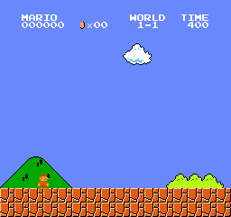
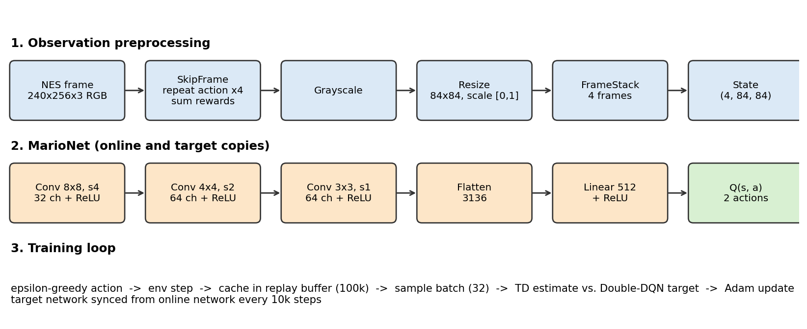
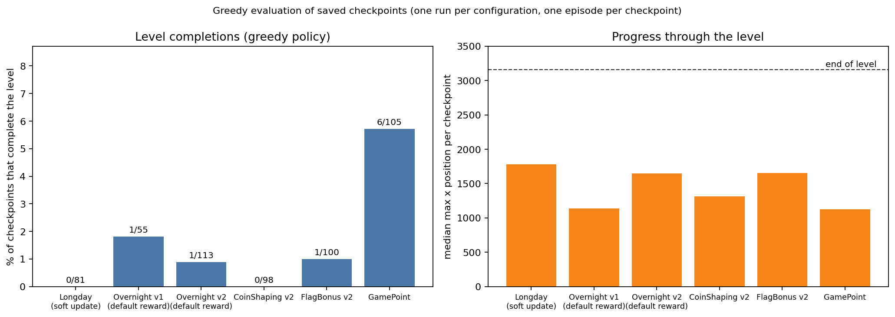

# Super Mario Agent

A Double Deep Q-Network (Double DQN) agent that learns to play level 1-1 of *Super Mario Bros.* directly from pixels, built with PyTorch. The project was developed for the *Fundamentals of Machine Learning* laboratory (3 CFU) and compares different **reward shaping** strategies and studies the **stability of DQN training**.

<p align="center">
  
</p>
Inspired by the PyTorch tutorial *Train a Mario-playing RL Agent* by Y. Feng, S. Subramanian, H. Wang and S. Guo: <https://h-huang.github.io/tutorials/intermediate/mario_rl_tutorial.html>

## Overview

The agent:

- observes the game as a stack of 4 grayscale 84x84 frames;
- chooses between two actions (`right`, `right + A`) with an epsilon-greedy policy;
- stores transitions in a replay buffer and learns with Double DQN (online and target networks);
- saves checkpoints, training metrics and periodic greedy evaluations.



## Project structure

| File | Purpose |
|---|---|
| `main.py` | Training and evaluation entry point (command-line interface). |
| `agent.py` | `Mario` agent: acting, replay buffer, Double DQN learning, checkpoints. |
| `neural_net.py` | `MarioNet`: small CNN with online and target copies. |
| `wrappers.py` | `SkipFrame`, `GrayScaleObservation`, `ResizeObservation`, `RewardShaping`. |
| `metric_logger.py` | Episode metrics, log file and plots. |
| `evaluate_checkpoints.py` | Greedy evaluation of every saved checkpoint of every run. |
| `evaluate_stochastic.py` | Robustness test: evaluation with random-action noise. |
| `make_readme_figures.py` | Regenerates the figures in this README. |

## Installation

```bash
git clone https://github.com/LytTheBit/Super_Mario_Agent.git
cd Super_Mario_Agent

conda create -n super-mario-agent python=3.10
conda activate super-mario-agent

pip install torch gym==0.26.2 gym-super-mario-bros==7.3.0 nes-py tensordict torchrl matplotlib "numpy<2"
```

Notes:

- The code was developed with `torch 2.11 + CUDA 12.8` (RTX 50-series GPUs need a CUDA 12.8 build of PyTorch, e.g. `pip install torch --index-url https://download.pytorch.org/whl/cu128`). A CPU also works, but training is much slower.
- Gym prints deprecation warnings (it is unmaintained and tied to NumPy 1.x); they are harmless.

## Quick start

```bash
# Smoke test (a few episodes, default settings)
python main.py --episodes 40

# Full training run
python main.py --run-name MyRun --episodes 40000 --save-every 250000 --log-every 250

# Resume an interrupted run (always pass the same --reward-mode and --epsilon-min again)
python main.py --run-name MyRun --episodes 40000 --load-checkpoint checkpoints/MyRun/mario_net_10.chkpt

# Watch a trained agent play (no learning, no exploration)
python main.py --load-checkpoint checkpoints/MyRun/best.chkpt --eval --render human --speed normal --episodes 3
```

## Command-line reference

### `main.py`

| Flag | Values | Default | Description |
|---|---|---|---|
| `--run-name` | text | timestamp | Name of the folder `checkpoints/<run-name>/`. |
| `--episodes` | integer | `40` | Number of episodes to train or play. |
| `--render` | `rgb` / `human` | `rgb` | `rgb` is fast and headless; `human` opens the game window. |
| `--speed` | `fast` / `normal` | `fast` | With `--render human`, `normal` plays at real NES speed. |
| `--load-checkpoint` | `.chkpt` path | none | Load weights, exploration rate and step counter. |
| `--eval` | flag | off | Evaluation only: greedy policy, no learning. |
| `--save-every` | integer (steps) | `500000` | Checkpoint frequency (`mario_net_N.chkpt`, N = step / save-every). |
| `--log-every` | integer (episodes) | `20` | Interval for logging and for the quick greedy evaluation. |
| `--reward-mode` | `none` / `flag-bonus` / `coin-shaping` / `game-score` | `none` | Reward function, see below. |
| `--epsilon-min` | float | `0.1` | Floor of the epsilon-greedy exploration rate. |

### Reward modes

| Mode | Reward |
|---|---|
| `none` | Default environment reward (progress to the right, time and death penalties). |
| `flag-bonus` | Default reward + 500 when the level is completed. |
| `coin-shaping` | Default reward + 10 x collected coins + flag bonus. |
| `game-score` | Default reward + 0.1 x in-game score gained + flag bonus. |

### Evaluating checkpoints

```bash
# Greedy evaluation of all runs in checkpoints/ (incremental, cached)
python evaluate_checkpoints.py

# Only some runs
python evaluate_checkpoints.py --runs MyRun

# Other options
python evaluate_checkpoints.py --episodes-per-checkpoint 1 --budget 18000000 --exclude RunToSkip
```

Writes `checkpoints/evaluation_all.csv` and `checkpoints/evaluation_all.md`. Evaluation uses the default reward for every run, so results are comparable across reward modes.

```bash
# Robustness: play with a fraction epsilon of random actions
python evaluate_stochastic.py --run MyRun --checkpoints mario_net_20 mario_net_21 \
    --epsilons 0 0.02 0.05 0.1 --episodes 20
```

Appends to `checkpoints/<run>/evaluation_stochastic.csv`.

### Regenerating the figures

```bash
python make_readme_figures.py
```

## Output files

Each run writes to `checkpoints/<run-name>/`:

| File | Content |
|---|---|
| `mario_net_N.chkpt` | Periodic checkpoints. |
| `best.chkpt` | Best checkpoint according to the quick greedy evaluation. |
| `config.json` | Hyperparameters and options of the run. |
| `log` and `*_plot.jpg` | Moving-average training metrics (reward, length, loss, Q value). |
| `quick_eval.csv` | Greedy evaluation every `--log-every` episodes. |
| `train_flags.csv` | Fraction of recent *training* episodes that reached the flag. |

## Default hyperparameters

| Parameter | Value |
|---|---|
| Discount factor `gamma` | 0.9 |
| Optimizer | Adam, learning rate 0.00025 |
| Loss | Smooth L1 |
| Batch size / replay buffer | 32 / 100,000 transitions |
| Burn-in / learn every | 10,000 steps / 3 steps |
| Target network sync | every 10,000 steps (hard copy) |
| Exploration | epsilon from 1.0, decay 0.99999975 per step, floor `--epsilon-min` |

## Results (snapshot)

Six comparable runs, each trained for roughly 14-28 million steps with a different reward configuration, one run per configuration. Every saved checkpoint was replayed with a purely greedy policy.



Main observations:

- The agent can complete level 1-1, but only some isolated checkpoints do: **no run converges to a stable policy**.
- A checkpoint that completes the level is often followed by checkpoints that fail (a typical DQN instability).
- Successful checkpoints are fragile: adding a small fraction of random actions quickly breaks them.
- The `game-score` reward gave the most completions, but with a single run per configuration the differences between reward modes are descriptive, not statistical.
- The `coin-shaping` reward shows signs of reward hacking (the agent is attracted by coins instead of advancing).

A further run with a lower exploration floor (`--epsilon-min 0.02`) is in progress; results will be added here.

## Notes

- Always use `--render rgb` for training; `human` is for demos only.
- `--eval` never updates the model and never explores.
- When resuming from a checkpoint the replay buffer restarts empty, which can briefly destabilise learning.
- Pass `--reward-mode` and `--epsilon-min` explicitly when resuming: they are not restored from the checkpoint.

## License

Educational and personal project. The tutorial code this work started from is by the PyTorch tutorial authors; the Super Mario Bros. image belongs to Nintendo and is used for illustration only.